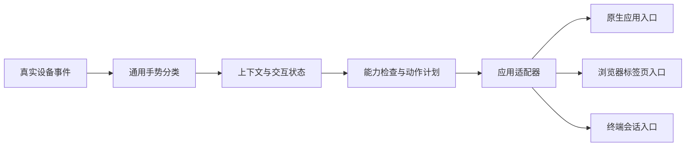

# VibeKey 多应用工作台设计

2026-10-29。个人 fork 的统一交互与原生界面设计。目标应用为 Codex、DeepSeek、Hugging Face、Claude Code、微信。第一条真实链路仍是当前 Codex；其余应用不因出现在界面里就被标记为已接入。

## 产品原则

- 用户操作一套：选择会话、确认、编辑、浏览、返回。应用差异放在适配器内部。
- 设备、手势识别、应用识别、会话定位、输入焦点和任务控制是不同层，不能只用“当前 App 名称”决定全部动作。
- 不增加一组开发者开关要求用户启用各功能。默认规则固定；启动时集中说明和检查系统权限。
- 实际连接、可用权限、运行状态与“待适配”分别表达；不把接口存在、进程启动或深链接受当作真实操作成功。
- 不改变模型调用配置或要求用户提供模型 API Key 来控制已打开的客户端。

## 原生界面

| 区域 | 日常内容 | 不放在这里的内容 |
|---|---|---|
| 工作台 | 当前就绪状态、选择会话、旋钮模式与按键用途 | HID 协议、捕获键、逐项启用开关 |
| 应用适配 | 应用入口、能力与实际接入状态、下一步验证目标 | 假的已支持状态、不可执行的停止／继续按钮 |
| 设备设置 | 原有键位、左右修饰键、灯光、麦克风、配置 | 导航总开关的重复副本 |
| 连接与权限 | 首次授权、设备等待、恢复提示、暂停并恢复原键位 | 每次使用都必须勾选的功能开关 |

固定导航开启时只保护 dialL/dialR/dialP/btn3 及整套配置切换；按钮1/2、外观、语言、灯效和声音继续可调。暂停为本次运行的临时操作，下次启动恢复默认规则。

首次集中呈现辅助功能、输入监控、麦克风、通知。导航仅依赖辅助功能与输入监控；麦克风与通知按需授权，拒绝不会阻止使用设置界面。权限引导可关闭返回工作台，必需权限不足时导航保持未接管。系统授权仍由 macOS 决定，程序不写 TCC 数据库，不将开关显示“开启”当成当前签名进程实际已获授权。当前使用 ad-hoc 签名，升级后可能需要重新选择应用；稳定签名是后续单独的部署事项。

菜单栏仅保留通用设备与设置功能，不提供 Codex 专用导航入口或模式状态块。会话管理统一从工作台进入，窗口名为“会话管理”。

## 统一交互

| 层级 | 旋转 | 短按旋钮 | 长按旋钮后释放 | 底部键 |
|---|---|---|---|---|
| 普通应用／基础输入 | ←／→ | 沿用设备原配置或已接入的焦点动作 | 仅已接入的导航入口 | 明确按所属工作流配置，不推断 AI 停止语义 |
| 会话选择列表 | 上／下一个候选 | 确认选中的会话 | 保留在选择层，不自动发送 | 取消列表，保留原会话 |
| 编辑 | 字符级左右移动 | 切到浏览 | 返回会话列表 | 退格；按住连删 |
| 浏览 | 由适配器提供内容移动 | 进入编辑并定位输入 | 返回会话列表 | 由应用能力决定，不能默认当作停止任务 |

以上是目标契约。lr.11 的兼容实现仍在内容层让真实聚焦键随每次旋钮按下到达 Codex，因此切回浏览的正文焦点尚未闭环；必须保留实机待验收，不能只改文案宣称解决。

长短按在释放时互斥判定，按压中切应用或改变上下文取消未完成手势。快速模式变更合并最新键位意图；过期回调不得覆盖新上下文。

## 分层与适配器契约

共享层维护 `ApplicationTarget`、`ConversationRef`、`InteractionMode`、`ContextEpoch`、`CapabilitySet`、`ActionResult`。会话身份至少包含应用、用户可见的入口／项目范围和会话标识，不能在应用间共享一个裸会话 UUID。

适配器对外提供：

- `identifyContext()`：识别应用及更具体的窗口、标签页或终端面板。仅用前台终端/Chrome的 bundle ID 不够。
- `capabilities(context)`：返回此上下文当前真的可用的能力，区分 implemented / configured / authorized / connected。
- `listConversations(scope)`：返回元数据、覆盖范围和分页信息，不默认扫描所有私人正文。
- `openExistingConversation(ref)`：打开已有会话，结果区分 requested / acknowledged / verified。
- `focusInputPlan(context)` / `browsePlan(context)`：给出此应用可用的原生入口或真实硬件键位方案。未知就返回 unavailable。
- `taskControl(intent, context)`：可选，stop/resume 分开。调用前核验任务和上下文；不向不支持该概念的应用发送近似快捷键。

动作结果包括 success、unavailable、needsPermission、targetChanged、retryableFailure。任何失败都不降级成向当前焦点发送猜测按键。此接口是后续适配器的契约，当前运行时仍通过原 Codex 控制器执行已实现链路；本轮实现共享应用目录、能力模型、固定默认规则和统一 UI，未宣称五个适配器均已完成。

## 各应用接入路径

用户于 2026-10-29 确认：DeepSeek 指本机 DeepSeek Harness；Hugging Face 指 HuggingChat 网页；Claude Code 指 Herdr／终端中的会话。以下入口已确定，接口能力仍须逐项验证。

| 应用 | 已确认入口 | 必须先验证 | 本轮状态 |
|---|---|---|---|
| Codex | 独立官方 app-server 的 thread/list、官方已有会话深链、用户原生聚焦快捷键 | 正文焦点、真实长短按完整链路、前台会话变化 | 原有链路沿用；真实键位读回通过，完整体验待验收 |
| DeepSeek | 本机 DeepSeek Harness | CLI／深链具体操作契约、会话范围、输入焦点 | 发现本机应用与 dsh URI；URI存在不等于已验证会话跳转 |
| Hugging Face | HuggingChat 网页 | 具体域名与标签页、登录态、页面结构、会话及输入定位 | 规划；未读取用户网页或登录数据 |
| Claude Code | Herdr／终端中的 Claude Code 会话 | 进程、项目、面板绑定，输入/转录区焦点与官方快捷键的上下文 | 规划；没有向现有任务发送命令或恢复提示 |
| 微信 | 本机 macOS 客户端 | 会话定位、输入框、正文滚动、会话切换后的确认 | 规划；没有读取联系人／聊天内容，也未发送消息 |

Claude Code 官方文档明确说明 Ctrl+C / Esc 的动作依运行状态与焦点而不同，因此不能把固定按键当作可靠的 stopTask。[官方交互文档](https://code.claude.com/docs/en/interactive-mode)

HuggingChat 的开源 chat-ui 是独立网页界面；它调用模型服务并不意味着模型推理 API 能定位已有浏览器会话。[官方仓库](https://github.com/huggingface/chat-ui)

## 本轮 Review 与处理

1. 导航时整块设置被禁用：本轮改为单槽保护，原版设备功能仍可用。
2. 首次授权漏输入监控：本轮集中到统一首次准备流程，权限齐全前不自动接管。
3. 固定行为仍暴露大量选项：本轮移除会话面板的启动、翻页、聚焦及监听开关；保留状态和恢复动作。
4. 自动重启曾停在 NSApp.terminate 的嵌套等待：改从主 run-loop 回调发起退出，并做真实异步清理退出自检。
5. ad-hoc签名导致授权记录不匹配：本轮不擅自安装证书或修改安全策略；后续采用稳定签名并独立验证。
6. 编辑／浏览切换与正文焦点没有完全闭环：保留明确限制，下一条真实路径优先解决；不把 Page 编辑器聚焦当作聊天正文。
7. 停止、继续、发送语义不能跨应用照搬：目录按能力显示；未完成能力不展示为可用。
8. 其他应用中底部键仍退格是旧兼容行为：多应用适配阶段需明确边界，不能让聊天停止键误变成别的应用的删除键。

## 迭代与验收

先完成一个可运行的通用外壳并保留 Codex 兼容链路，再逐个增加适配器，每次至少验证：目标上下文识别 → 会话定位 → 输入编辑 → 内容浏览 → 返回列表 → 离开应用 → 原值恢复。先用一条具体路径证明可行，再扩展更多应用／版本。

暂停或退出必须逐项恢复原始键位；首次启动遇到旧恢复记录，先核验并恢复原值，成功后才重新准备。诊断模式与普通模式隔离；原始记录保留到确认恢复成功。

本设计只新增应用范围，不自动扩充消息发送、账户或其他软件权限。浏览器／终端不可确认目标时停止分派；微信等没有 AI 任务状态的应用不提供停止／恢复任务动作。

## 2026-10-30 签名身份修正

最初诊断的安装包及旧包均为 ad-hoc，指定要求仅含各自 cdhash；当时 tccd 日志确认辅助功能、输入监控均因旧代码要求不匹配失败。问题不在反复重启。打包脚本现要求显式可用的长期签名身份，缺少配置时在构建前停止，不再自动退回临时签名。可抛弃测试包必须显式使用 VIBEKEY_ALLOW_ADHOC=1，不能声称可保留更新授权。

最初诊断时本机无可用身份；此后已按下节完成用户批准的长期签名迁移。固定身份后需两次不同构建验证指定要求一致，并在实际更新后复核权限。迁离旧临时身份仍可能需要一次授权，不承诺凭打包防护就已解决当前权限。

## 本机长期证书进度（2026-10-30）

用户选择本机个人证书，并进一步明确批准仅此证书、当前用户、代码签名用途的信任。已创建 CA:false、CodeSigning EKU 的十年证书及登录钥匙串私钥；用户信任快照确认仅增加该证书的 CodeSigning 策略，既有条目不变。自动构建配置复用精确指纹，密钥和配置不进入仓库。

用户完成首次私钥确认及 A 版一次迁移授权后，已正常更新至 lr.14 B/build22。A/build21 与 B/build22 的 CDHash 不同、证书指定要求一致；资源、41项修饰键、深度签名与主应用交叉要求检查通过。升级过程未修改系统授权，B 自身权限页仍显示辅助功能与输入监控已准备，新主进程自动导航成功。此为同一实现、不同包构建元数据的一次真实更新验证；未重新验收物理手势。外部 shell 探针被归因到 Codex，不能用于判断 VibeKey 授权；真实应用上下文结果为准。

长期多项目及对外发布建议见 [签名策略](SIGNING.md)。该建议未执行任何新证书轮换或对外分发。
